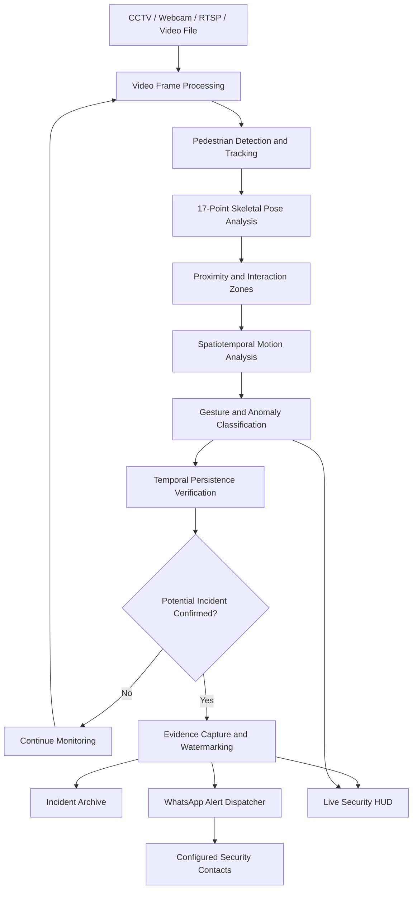
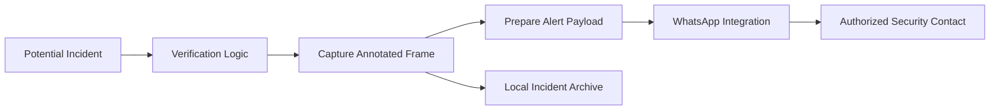

# 🛡️ WomenSafety — CCTV Threat & Anomaly Surveillance System

<p align="center">
  
  
  
  
</p>

<p align="center">
  
  
  
  
</p>

**WomenSafety** is an AI-assisted CCTV threat and anomaly surveillance system designed to support women's safety in public spaces, transport hubs, campuses, and monitored facilities.

The system analyzes video streams, tracks people across frames, evaluates skeletal movement and interactions, and identifies patterns that may indicate physical altercations or threatening behavior. When a potential incident meets the configured verification criteria, the system can capture evidence, generate a location-aware alert, and notify designated responders through a configured WhatsApp integration.

> **Mission:** Help security teams identify potentially dangerous situations earlier through computer vision, behavioral analysis, and timely incident reporting.

**Repository:** [reddy895/WomenSafety](https://github.com/reddy895/WomenSafety)

---

## 📑 Table of Contents

- [Overview](#-overview)
- [Problem Statement](#-problem-statement)
- [Key Features](#-key-features)
- [System Architecture](#️-system-architecture)
- [How It Works](#-how-it-works)
- [Behavior Classification](#-behavior-classification)
- [Emergency Alert System](#-emergency-alert-system)
- [Live Surveillance Dashboard](#-live-surveillance-dashboard)
- [Operating Modes](#️-operating-modes)
- [Technology Stack](#️-technology-stack)
- [Getting Started](#-getting-started)
- [Configuration](#️-configuration)
- [API and Integration Notes](#-api-and-integration-notes)
- [Testing and Validation](#-testing-and-validation)
- [Security and Privacy](#-security-and-privacy)
- [Limitations](#️-limitations)
- [Future Improvements](#-future-improvements)
- [Contributing](#-contributing)
- [License](#-license)

---

## 🎯 Overview

Traditional surveillance systems primarily record footage for later review. Identifying a developing altercation may require continuous human monitoring, and reviewing recorded footage can take considerable time.

WomenSafety aims to support surveillance operators by analyzing movement patterns and interactions as video is processed.

### The problem

- Large numbers of camera feeds can be difficult to monitor continuously.
- Physical altercations may develop quickly.
- Harmless gestures can resemble threatening movement when viewed in isolated frames.
- Security teams need actionable incident details to investigate potential threats.
- Manual evidence collection and incident reporting can delay response.

### The proposed solution

WomenSafety combines pedestrian tracking, skeletal pose analysis, interaction monitoring, temporal verification, evidence capture, and configurable emergency notifications in a single surveillance workflow.

### Intended applications

- College and university campuses
- Public transport facilities
- Parking areas and corridors
- Commercial buildings
- Public spaces with authorized CCTV monitoring
- Security control rooms

The system is intended to **assist human security personnel**, not replace emergency services, trained operators, or established incident-response procedures.

---

## ✨ Key Features

### 🎥 1. Multiple Video Input Sources

The documented system supports several video input modes:

- Live webcam or USB camera
- RTSP network camera streams
- Recorded video files such as MP4, AVI, and MKV

Each frame is passed through the processing pipeline for detection and behavioral analysis.

### 👥 2. Pedestrian Detection and Tracking

- Detects people appearing in the video.
- Assigns tracking IDs to individuals.
- Tracks bounding boxes and central coordinates across frames.
- Maintains movement history for behavioral analysis.

Tracking quality depends on camera angle, image resolution, occlusion, lighting, and crowd density.

### 🦴 3. Skeletal Pose and Motion Analysis

The documented design uses 17 skeletal landmarks to examine body movement.

Tracked landmarks include:

- Head and facial reference points
- Shoulders, elbows, and wrists
- Hips and torso reference points
- Knees and ankles

These coordinates help characterize posture, arm motion, body lean, and movement during close interactions.

### 📏 4. Proximity and Interaction Detection

The system monitors spatial relationships between people.

- Estimates inter-person distance.
- Checks bounding-box overlap.
- Identifies potential interaction zones.
- Maintains movement history for selected person pairs.

This approach focuses additional analysis on interactions that may require closer examination.

### 📈 5. Spatiotemporal Motion Analysis

The system evaluates movement patterns across consecutive frames, including:

- Upper-limb velocity and acceleration
- Torso lean and postural asymmetry
- Bounding-box movement and distortion
- Approach speed and distance changes
- Relative wrist positions and elevation

These features are intended to help distinguish ordinary movement from patterns associated with physical struggles.

### 🧠 6. Gesture and Anomaly Classification

The system is designed to distinguish benign interactions from potentially threatening behavior.

Examples include walking, handshakes, high-fives, friendly hugs, pushing, grabbing, lunging, and physical altercations.

### ⏱️ 7. Temporal Verification

A configurable persistence threshold helps filter out brief, isolated movements.

The documented design describes a typical threshold of at least 1.5 seconds for sustained suspicious behavior. This value should be calibrated and evaluated against representative video rather than treated as a universally reliable detection rule.

### 📸 8. Evidence Capture and Watermarking

For a qualifying incident, the system is designed to capture an annotated frame containing relevant metadata, such as:

- Incident classification
- Timestamp
- Camera node identifier
- Configured geographic coordinates

Captured evidence can be stored in a local incident archive for authorized review.

### 📲 9. Emergency WhatsApp Notifications

With a functioning and configured messaging integration, an alert can include:

- Incident warning
- Camera identifier
- Timestamp
- Location information
- Google Maps link
- Annotated evidence image

Background dispatch and cooldown logic are intended to reduce delays and repeated notifications.

### 🖥️ 10. Live Security HUD

The surveillance interface is designed to display:

- Bounding boxes around detected people
- Skeletal landmark overlays
- Interaction and threat indicators
- Active tracking information
- Processing and monitoring telemetry

---

## 🏗️ System Architecture

The following Mermaid diagram represents the system workflow described in the project documentation.



### Component responsibilities

| Component | Responsibility |
|---|---|
| Video ingestion | Reads live camera streams and recorded video |
| Pedestrian tracking | Tracks detected people between frames |
| Pose estimation | Extracts skeletal landmarks |
| Interaction analysis | Evaluates proximity and movement between people |
| Anomaly classification | Identifies potentially threatening motion patterns |
| Temporal verification | Checks whether suspicious behavior persists |
| Evidence handler | Captures and annotates relevant frames |
| Alert dispatcher | Sends notifications through the configured integration |
| Incident archive | Stores evidence for authorized review |
| Security HUD | Presents visual tracking and alert information |

**Architecture note:** This is a logical workflow based on the supplied project documentation. The actual execution order and the availability of individual components should be verified against the current source code.

---

## 🔬 How It Works

### Stage 1 — Video ingestion

The system reads frames from a supported camera or video file, decodes them, and passes them to the processing pipeline.

### Stage 2 — Person detection and tracking

Detected individuals receive tracking IDs. Their bounding boxes and coordinates are recorded over successive frames to establish movement trajectories.

### Stage 3 — Skeletal landmark extraction

The pose-analysis stage extracts body landmarks, providing geometric information about limb positions and body posture.

### Stage 4 — Interaction-zone detection

The system checks the proximity of people and activates additional interaction analysis when configured distance or overlap criteria are met.

### Stage 5 — Motion feature extraction

Movement history is evaluated for patterns such as sudden arm acceleration, rapid changes in relative distance, unusual torso lean, and unstable movement during close contact.

### Stage 6 — Behavior classification

The classifier evaluates the extracted information to identify possible benign interactions or suspicious behavior.

### Stage 7 — Temporal verification

Potential threats are checked against a configurable persistence window to reduce alerts triggered by brief, isolated movements.

### Stage 8 — Evidence and incident reporting

When an event qualifies for escalation, the system can capture a frame and annotate it with available incident metadata.

### Stage 9 — Notification dispatch

If the messaging integration is configured and operational, the alert dispatcher sends the incident information to designated contacts.

### Stage 10 — Visual monitoring

The dashboard provides tracking overlays and incident indicators to support security personnel during monitoring and review.

---

## 🧠 Behavior Classification

A key challenge is avoiding unnecessary alerts for ordinary human interaction.

| Interaction | Example observations | Intended handling |
|---|---|---|
| Normal walking | Consistent movement and ordinary arm swing | Routine monitoring |
| Handshake or high-five | Brief hand contact and limited interaction duration | Potentially benign |
| Friendly hug | Close contact with movement patterns consistent with an embrace | Potentially benign |
| Sudden physical contact | Rapid changes in limb positions or inter-person distance | Additional evaluation |
| Physical struggle | Sustained irregular movement, pushing, grabbing, or unstable posture | Potential incident escalation |

These are behavioral indicators, not definitive proof of intent or assault. A single movement feature cannot reliably establish whether an interaction is harmless or violent.

### False-positive reduction

The documented approach includes:

- Evaluating movement over multiple frames
- Maintaining interaction histories
- Checking temporal persistence
- Using a cooldown period for repeated incident alerts
- Suppressing selected benign patterns

Actual precision and recall should be measured using labeled test videos, including challenging scenarios and ordinary social interactions.

---

## 🚨 Emergency Alert System

When a potential incident passes the configured verification stage, the system is designed to prepare an incident notification.

### Example alert

```text
⚠️ RED ALERT: Potential Physical Altercation Detected

📍 Location: Surveillance Node 01
📌 Coordinates: 12.9716, 77.5946
🕒 Timestamp: [Incident Timestamp]

🗺️ Google Maps:
https://maps.google.com/?q=12.9716,77.5946

📸 Evidence: [Attached or Archived Snapshot]
```

The coordinates above are illustrative. Real alerts must use the correct configured camera location and timestamp.

### Notification workflow



### Alert safeguards

- Apply a configurable cooldown to repeated detections.
- Include a camera identifier and timestamp.
- Validate configured coordinates before generating location links.
- Record dispatch success or failure where supported.
- Avoid treating a successful API request as proof that a recipient received or acted on an alert.
- Ensure a human responder can verify the incident.

**Important:** WhatsApp alerts require a configured and authorized messaging integration. The availability of alerting, image delivery, background dispatch, and delivery-status tracking depends on the implementation and credentials. Do not assume these functions are operational until they have been tested end to end.

---

## 🖥️ Live Surveillance Dashboard

The documented HUD design uses visual overlays to communicate the current monitoring state.

| Indicator | Intended meaning |
|---|---|
| 🟢 Green | Normal pedestrian tracking |
| 🟡 Yellow | Close interaction under evaluation |
| 🔴 Red | Potential or verified threat state, depending on implementation |

Additional telemetry may include:

- Number of active tracked individuals
- Monitoring status
- Processing speed
- Skeletal pose landmarks
- Current incident classification
- Alert and evidence information

Color indicators should communicate system confidence and verification state clearly. They must not imply that a suspected incident has been independently confirmed when it has not.

---

## ⚙️ Operating Modes

### 1. Interactive launch

The documented interface provides an interactive mode selector.

- **Live camera mode:** Uses a supported local camera or connected video source.
- **Video file mode:** Analyzes prerecorded video for testing and review.

### 2. Visual mode

Displays the live video preview, tracking boxes, pose landmarks, and available threat indicators.

### 3. Headless edge mode

Runs without a graphical preview window, for environments where background processing is required.

Actual camera support, command-line flags, and headless behavior depend on the current application implementation.

---

## 🛠️ Technology Stack

The supplied project documentation describes the following capabilities and components.

| Layer | Technology or approach |
|---|---|
| Language | Python |
| Video processing | OpenCV-based video ingestion, where implemented |
| Person detection | Computer vision detection model |
| Pose analysis | 17-point skeletal landmark representation |
| Tracking | Persistent person tracking |
| Behavioral analysis | Spatiotemporal motion features |
| Classification | Gesture and anomaly classification |
| Evidence management | Annotated frame capture and local archive |
| Messaging | Configured WhatsApp integration |
| Visualization | Real-time HUD overlays |
| Execution | Interactive visual and headless modes |

Confirm exact package names, model versions, and dependencies against the repository's `requirements.txt` and source files before documenting them as installed components.

---

## 🚀 Getting Started

### Prerequisites

Before starting, verify that your environment has:

- Python compatible with the project's dependency versions
- Git
- A camera, supported RTSP stream, or sample video file
- Required computer vision model weights
- Optional messaging credentials and configuration if testing notifications

### 1. Clone the repository

```bash
git clone https://github.com/reddy895/WomenSafety.git
cd WomenSafety
```

### 2. Create a virtual environment

**Linux / macOS**

```bash
python3 -m venv .venv
source .venv/bin/activate
```

**Windows PowerShell**

```powershell
python -m venv .venv
.venv\Scripts\Activate.ps1
```

### 3. Install dependencies

If the repository includes `requirements.txt`:

```bash
python -m pip install --upgrade pip
pip install -r requirements.txt
```

If dependency installation fails, consult the repository's documented Python version and platform requirements.

### 4. Check model and configuration files

Before launching, verify that the model weights and any required configuration files are present. Follow the actual repository instructions for downloading or configuring model files.

Do not assume pretrained weights are included in the Git repository.

### 5. Launch the application

Use the project's documented entry point. If the repository provides `main.py`, the launch command may be:

```bash
python main.py
```

The exact entry point and accepted command-line options should be confirmed against the current source code.

### 6. Test with a video file first

Start with a short, locally stored video to validate the detection pipeline before connecting live surveillance equipment or enabling emergency notifications.

---

## ⚙️ Configuration

Configuration requirements depend on the current implementation.

Before using the system, identify and verify the settings for:

| Setting | Purpose |
|---|---|
| Video source | Camera index, RTSP URL, or video path |
| Detection weights | Path to the configured detection model |
| Pose model | Pose estimation weights or configuration |
| Tracking | Tracking algorithm and parameters |
| Threat threshold | Criteria for flagging suspicious behavior |
| Persistence window | Minimum duration before escalation |
| Camera ID | Identifier used in incident records |
| Camera coordinates | Location used to generate map links |
| Alert contacts | Authorized notification recipients |
| Messaging credentials | Credentials required by the chosen WhatsApp integration |
| Evidence directory | Location for saved incident snapshots |
| Alert cooldown | Interval for suppressing repeated notifications |

Use environment variables or a local configuration file when supported. Keep credentials, private camera URLs, and other sensitive settings out of source control.

---

## 🔌 API and Integration Notes

The supplied README describes a Python surveillance application and does not specify a formal HTTP API contract.

The primary integrations described are:

- Camera and video input sources
- Computer vision and pose estimation components
- Local incident evidence storage
- WhatsApp messaging
- Google Maps location links

If a backend API is added, document its routes, request and response schemas, authentication requirements, error handling, and health checks separately.

---

## 🧪 Testing and Validation

A safety-oriented surveillance system requires more than a successful application launch.

### Basic verification checklist

- [ ] The application starts without dependency errors.
- [ ] A supported video source opens successfully.
- [ ] People are detected in representative frames.
- [ ] Tracking IDs remain reasonably consistent during movement.
- [ ] Pose landmarks are extracted when the selected model supports them.
- [ ] Normal walking and ordinary social interactions are evaluated.
- [ ] Potential altercations trigger the expected verification workflow.
- [ ] Brief, isolated movements do not routinely trigger alerts.
- [ ] Incident snapshots contain the correct available metadata.
- [ ] Configured coordinates produce correct map links.
- [ ] WhatsApp messages are tested with authorized recipients.
- [ ] Failed notification attempts are handled safely.
- [ ] Headless mode behaves as documented.
- [ ] Evidence is stored only in the intended location.

### Recommended evaluation metrics

Measure detection performance on a representative, labeled dataset.

- Precision and recall
- False-positive rate
- Missed-incident rate
- Detection latency
- Processing throughput
- Alert dispatch success rate
- Performance under different lighting and camera angles

Do not describe the system as accurate, reliable, or production-ready without supporting evaluation results.

---

## 🔐 Security and Privacy

Video surveillance involves sensitive personal data and requires responsible deployment.

### Recommended safeguards

- Obtain the required permissions before accessing cameras.
- Follow applicable privacy, surveillance, and data-protection requirements.
- Restrict access to live feeds and archived evidence.
- Protect messaging credentials and camera connection details.
- Store evidence securely and establish retention limits.
- Avoid collecting or sharing more footage than necessary.
- Log incident access and notification actions where appropriate.
- Test the system on authorized footage before operational use.
- Provide human review for consequential decisions.
- Ensure an alert is not treated as definitive evidence of wrongdoing.

### Responsible deployment

WomenSafety is intended to support safety monitoring. Automated detections may be wrong because of occlusion, camera placement, unusual movement, poor image quality, or ambiguous interactions.

The system should assist trained personnel rather than automatically determine guilt, identify a perpetrator, or make consequential decisions without verification.

---

## ⚠️ Limitations

- Motion features alone cannot establish intent.
- Friendly interactions and physical struggles can look similar in some camera views.
- Tracking and pose estimation can fail in crowded or low-quality footage.
- Detection performance depends on the model, data, camera placement, and environmental conditions.
- A temporal threshold reduces some false alarms but cannot eliminate them.
- Location links are only useful when camera coordinates are correctly configured.
- WhatsApp dispatch depends on valid credentials, provider availability, and correct integration.
- Recorded-video success does not guarantee equivalent performance on live streams.
- Static or scripted test scenarios do not establish real-world safety effectiveness.

These limitations should be considered during testing, deployment, and interpretation of alerts.

---

## 🗺️ Future Improvements

Potential enhancements include:

- [ ] Evaluation on diverse, labeled video datasets
- [ ] Improved multi-person tracking under occlusion
- [ ] Calibrated confidence scores and configurable thresholds
- [ ] Event review and human verification workflow
- [ ] Multi-camera incident management
- [ ] Secure incident history and audit logs
- [ ] Configurable notification escalation
- [ ] Better notification delivery monitoring
- [ ] Performance optimization for edge devices
- [ ] Automated regression tests for benign and threatening interactions
- [ ] Privacy-aware evidence retention and access controls

These items represent potential future work, not a claim that they are already implemented.

---

## 🤝 Contributing

Contributions that improve detection quality, maintainability, security, and responsible incident handling are welcome, subject to the repository's contribution policy.

1. Fork or clone the repository.
2. Create a focused feature branch.
3. Make changes with clear scope.
4. Test against representative video scenarios.
5. Document configuration changes and new dependencies.
6. Check for privacy and security implications.
7. Submit a pull request with a summary of the changes and test results.

For detection-related changes, include evidence of both positive cases and benign interactions to help assess false positives.

---

## 📄 License

This project is licensed under the **MIT License**.

See the [LICENSE file](https://github.com/reddy895/WomenSafety/blob/main/LICENSE) for the complete terms.

---

<p align="center">
  <strong>WomenSafety — Smarter Surveillance. Faster Awareness. Safer Spaces.</strong>
  <br />
  <sub>AI-assisted threat and anomaly monitoring for responsible safety operations.</sub>
</p>
